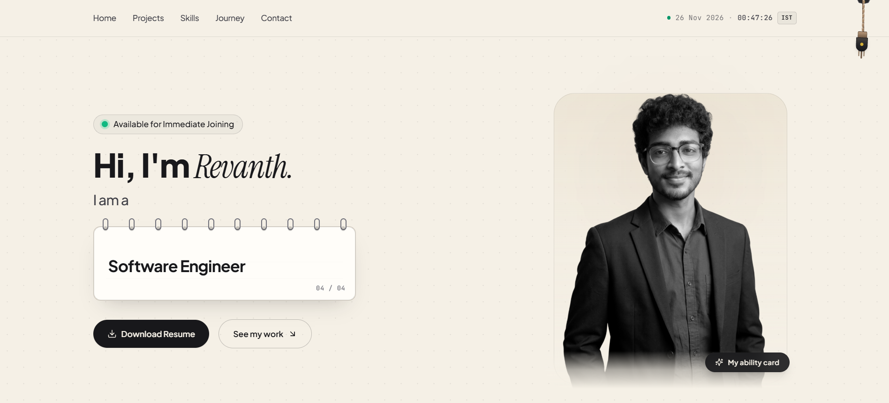

# Revanth Bolla — Developer Portfolio

Personal developer portfolio showcasing full-stack engineering projects, core technical skills, and career journey.

[](https://react.dev/)
[](https://vitejs.dev/)
[](https://tailwindcss.com/)
[](https://www.framer.com/motion/)

**Live Demo:** [https://revanth-bolla-portfolio.vercel.app/](https://revanth-bolla-portfolio.vercel.app/)

---

## Preview



---

## Key Highlights

- **Interactive Pull-Cord Theme Toggle:** Hanging braided rope anchored at the top-right with pendulum and spring physics—pull down, drag sideways, or click to switch between Warm Editorial Cream (Light) and Matte Obsidian Gold (Dark) modes.
- **Hero Spotlight & Flip Notebook:** Split-screen hero featuring a spiral-bound 4-role flip notebook (`01 / 04`) and a monochrome-to-color radial cursor spotlight over the studio portrait.
- **3D Collectible Ability Card Modal:** Opens from the hero portrait with floating golden embers, a diagonal molten-gold burn-in reveal, 3D hover tilt, 360° Y-axis drag rotation, and an ornate golden compass/clockwork card back.
- **Responsive Design:** Zero horizontal overflow and smooth interactions across mobile (`375px`), tablet (`768px`), and desktop (`1440px+`), paired with a sticky IST clock and mobile navigation drawer.
- **Featured Engineering Projects & Sticky Timeline:** Editorial dark-card showcase for deployed full-stack apps and a `"Let's Go Back in Time"` sticky split-screen engineering timeline.

---

## Featured Projects

### 1. Money Manager — Full-Stack Financial Analytics App
End-to-end personal finance and expense tracking platform built with Java, Spring Boot, Spring Security (stateless JWT), PostgreSQL, React, Docker, and JUnit 5. Includes Apache POI Excel reporting, Cloudinary media uploads, scheduled email alerts, and resolved Hibernate N+1 SQL bottlenecks using composite indexes, DTO projections, and `@EntityGraph`.
- **Live Demo:** [https://mmoneymanager.netlify.app/](https://mmoneymanager.netlify.app/)
- **Repository:** [https://github.com/BollaRevanth/Money-Manager](https://github.com/BollaRevanth/Money-Manager)

### 2. Foodel — Full-Stack Food Delivery Platform
Production food ordering and catalog management web application built on the MERN stack (`MongoDB`, `Express.js`, `React.js`, `Node.js`) with Google OAuth2 authentication, live search and filtering, automated promo pricing rules, real-time order tracking, and a role-based admin dashboard.
- **Live Demo:** [https://food-delivery-frontend-h8j6.onrender.com/](https://food-delivery-frontend-h8j6.onrender.com/)
- **Repository:** [https://github.com/BollaRevanth/Food-Delivery-Project](https://github.com/BollaRevanth/Food-Delivery-Project)

---

## Run Locally

```bash
# 1. Clone the repository
git clone https://github.com/BollaRevanth/Revanth-Bolla-Portfolio.git

# 2. Navigate to the project directory
cd Revanth-Bolla-Portfolio

# 3. Install dependencies
npm install

# 4. Start the local development server
npm run dev

# 5. Create a production build
npm run build
```

---

## Connect

- **Email:** [revanthbolla2948@gmail.com](mailto:revanthbolla2948@gmail.com)
- **LinkedIn:** [linkedin.com/in/revanthbolla](https://www.linkedin.com/in/revanthbolla/)
- **GitHub:** [github.com/BollaRevanth](https://github.com/BollaRevanth)
- **Resume:** [View my Resume](https://drive.google.com/file/d/1xiBlUQjvRMj3Q1ZLceCgCwfvo-e5oWSY/view?usp=sharing)

---
